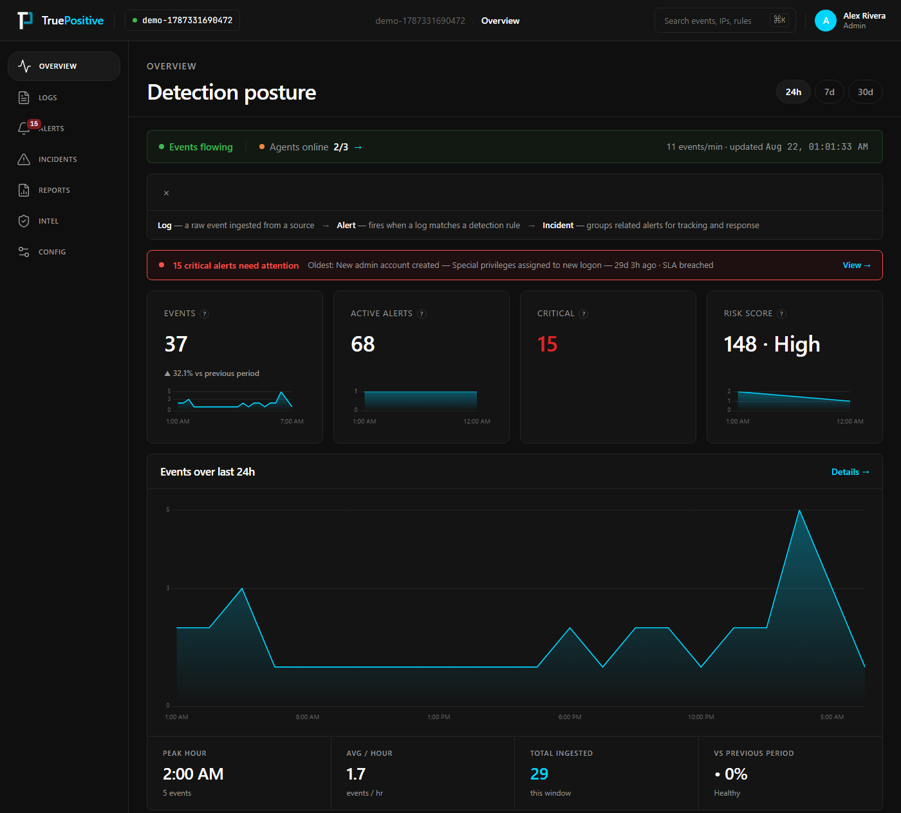
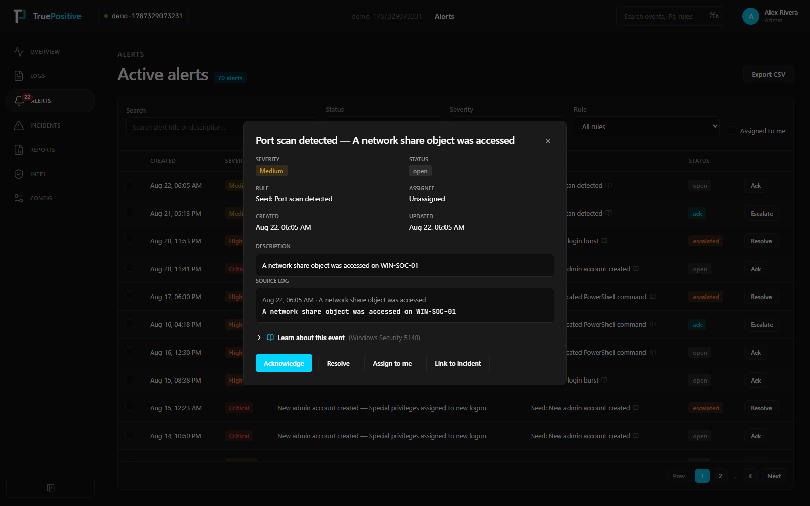
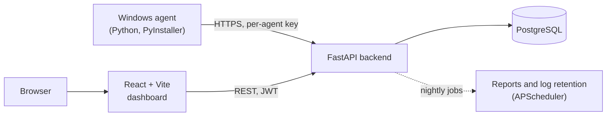

# TruePositive

**A beginner-friendly SIEM.** A small Windows agent collects security logs, the server scores them against detection rules, and the dashboard shows real alerts in plain language, without the jargon of an enterprise console.

[](https://github.com/gncrlatienza-eng/truepositive/actions/workflows/ci.yml)
[](https://github.com/gncrlatienza-eng/truepositive/releases/latest)
[](LICENSE)

**Live:** [truepositive-alpha.vercel.app](https://truepositive-alpha.vercel.app)



## Why

Splunk, Sentinel and QRadar assume you already know security operations. TruePositive keeps the same core loop (collect events, detect, triage, respond) and explains each step to someone seeing it for the first time: what a Windows event ID means, what a MITRE technique is, and why an alert fired.

## Features

- **Windows agent:** a one-click installer that collects Windows Event Logs (Security, Sysmon, PowerShell, System, Application, Firewall, DNS) and sends them over HTTPS. It checks its own permissions and fixes missing log access or a missing Sysmon install through a tightly scoped admin step.
- **Detection rules:** tunable rules mapped to MITRE ATT&CK, with severity scoring and an allow-list for known-good activity.
- **Alert triage:** each alert gives a plain-language explanation of the event, a MITRE glossary and the source log line.
- **Incidents and playbooks:** group alerts into incidents with a status workflow and response deadlines. Playbook actions are recorded, but not yet executed.
- **Reports:** daily, weekly, monthly and compliance reports, generated automatically each night and exportable to PDF.
- **Threat intel:** a curated indicator feed checked against your own logs, alerts and incidents.
- **Multiple devices:** a dashboard per device, a primary device, and an optional hub mode that relays traffic for devices on the same LAN.



## Architecture



| Layer | Stack |
|---|---|
| Frontend | React, Vite, Chart.js, d3-geo (hosted on Vercel) |
| Backend | FastAPI, SQLAlchemy 2.0, Alembic, APScheduler (hosted on Render) |
| Database | PostgreSQL (hosted on Supabase) |
| Agent | Python, PyInstaller, Inno Setup, released through GitHub Actions |
| Local dev | Docker Compose |

## Engineering highlights

- **Removed a privilege escalation in the agent's own design.** The agent originally ran its admin tasks from a folder the user could write to, so any process in that user session could gain admin rights. It now runs two fixed scripts from an admin-only `%ProgramFiles%` folder and passes the UAC fallback inline, with nothing written to disk. ([audit](docs/AUDIT_2026-10-04.md))
- **Fixed a silent ingestion stall after reboots.** When a Windows event channel was cleared or restarted, its record IDs started again from a low number, so the agent kept asking for events after a number that no longer existed and received nothing, without any error. It now notices the reset and starts again from the newest event. The fix is covered by regression tests.
- **Security reviewed against OWASP ASVS.** [`SECURITY.md`](SECURITY.md) lists what is covered and what is still missing. Covered so far: rate limiting, encrypted credential storage (Fernet), a Content-Security-Policy, a non-root container, a signup invite gate, and a file-path allow-list on the agent so that a compromised server cannot read arbitrary files.
- **Runs on free tiers.** Supabase, Render and Vercel each run on their free plan. A scheduled GitHub Action keeps the database and API from going to sleep, the health check queries the database for real, and the server refuses to start with an invalid configuration rather than failing later.
- **Checked in CI on every push.** Backend: ruff, mypy, 240+ pytest tests and migrations against a real Postgres. Agent: tests on Windows. Frontend: eslint, Prettier and a production build.

## Run it locally

```bash
cp env.example .env        # fill in JWT_SECRET and CREDENTIAL_ENCRYPTION_KEY
docker compose up -d
docker compose exec backend alembic upgrade head
```

Open http://localhost:3100 and sign up. To fill the dashboard with sample data:

```bash
docker compose exec backend python scripts/seed_dashboard_data.py <org-slug>
```

To connect a real agent, use **Settings → Sources → Deploy an agent** and download the Windows installer, or run `python agent/tp_agent.py --url http://localhost:8000 --id <id> --key <key>`.

## Docs

| | |
|---|---|
| [`docs/DEPLOY_FREE.md`](docs/DEPLOY_FREE.md) | Free cloud deployment (Supabase, Render, Vercel) |
| [`docs/SELF_HOSTING.md`](docs/SELF_HOSTING.md) | Environment variables, single-VM and Tailscale setup, troubleshooting |
| [`SECURITY.md`](SECURITY.md) | Security posture and how to report a vulnerability |
| [`docs/AUDIT_2026-10-04.md`](docs/AUDIT_2026-10-04.md) | Full-stack audit: findings and fixes |
| `backend/`, `frontend/`, `agent/` READMEs | Per-component setup and commands |

## Roadmap

- Linux agent (the collection code exists but is untested), plus Docker and Kubernetes deployment
- MFA, password reset and email verification
- Playbook actions that actually run
- Mobile app (React Native, scaffold only)

## License

[MIT](LICENSE)
